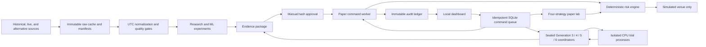

# Architecture and public contracts

## System shape

The dashboard never calls trading logic directly. Paper, validation, and generation workers claim
disjoint command prefixes. The paper worker and each active coordinator own separate sleep leases.
Trial processes return results to one coordinator writer; they never write SQLite. SQLite WAL stores
structured state and commands; Parquet stores market/features; report/model artifacts stay local
and ignored by Git.

Generation 6 uses dedicated `generation6.` and `paper6.` prefixes. Its paper worker reuses the
audited Generation 5 session and maximum-holding semantics without changing Generation 5's sealed
implementation files. A `live-g6` state marker prevents both paper workers from restoring the same
continuous session after restart.

The experimental paper lab uses the disjoint `paperlab.` command prefix and four namespaced account
states. It shares one external quote fetch per poll cycle, then gives each engine an event-ID-distinct
copy. Each engine keeps the normal one-position rule, producing a maximum of four aggregate XAUUSD
positions without combining balances or bypassing per-account risk limits. The normal paper worker
and lab cannot start at the same time.

## Domain records

Every record is schema-versioned, immutable, UTC-aware, and has event, correlation, causation, dataset, configuration, strategy, and model identifiers where applicable.

`Quote`, `Bar`, `DatasetManifest`, `FeatureVector`, `Signal`, `ModelScore`, `OrderIntent`, `RiskDecision`, `SimulatedOrder`, `Fill`, `Position`, `AccountSnapshot`, `Approval`, `KillSwitchEvent`, and `PaperTradeClosed` are the canonical wire and audit shapes.

## Extension ports

- `MarketDataProvider`: backfill, stream, symbol specification, entitlement metadata, and health.
- `AlternativeDataProvider`: point-in-time records with event/publication/availability timestamps.
- `FeaturePipeline`: as-of-safe transformation.
- `Strategy`: deterministic signal or no signal.
- `ModelScorer`: calibrated score for an existing signal.
- `RiskEngine`: final allow/deny and size decision.
- `ExecutionVenue`: submit, cancel, and reconcile. V1 registers simulation only.
- `ExperimentRunner`: chronological training, evaluation, artifact, and report lifecycle.

## Command and API surface

CLI covers doctor, data import, research, reports, secret management, server, paper start/stop, and kill/reset. HTTP exposes read-only status/research/audit/lab state and CSRF-protected approval/paper/lab/risk actions. It deliberately has no order-entry endpoint.

## State transitions

Paper states include `stopped`, `running`, `risk-halted`, `approval-invalidated`, `recovery-required`, and `killed`; the lab additionally reports `error` when its exact four-account preparation fails. Live-mode feeds start fail-closed until freshness and reconciliation pass. Approval is a separate immutable capability that can be invalidated but not edited. Generation states include `sealed`, `running`, `paused`, `resource-paused`, `futile`, `stopped`, `failed`, and `completed`. Final-validation jobs use `queued`, `running`, `completed`, and `failed` durable states.

## Storage and migration

SQLAlchemy models and Alembic migrations define the same schema. Runtime initialization is idempotent for a fresh local database. Raw/normalized data, model artifacts, database files, and reports are excluded from Git; manifests and schemas describe how they were produced.
